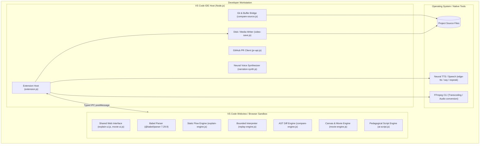
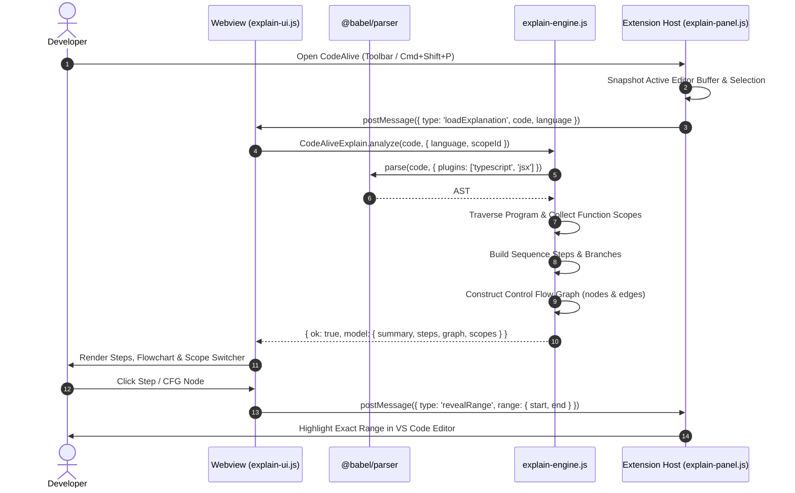
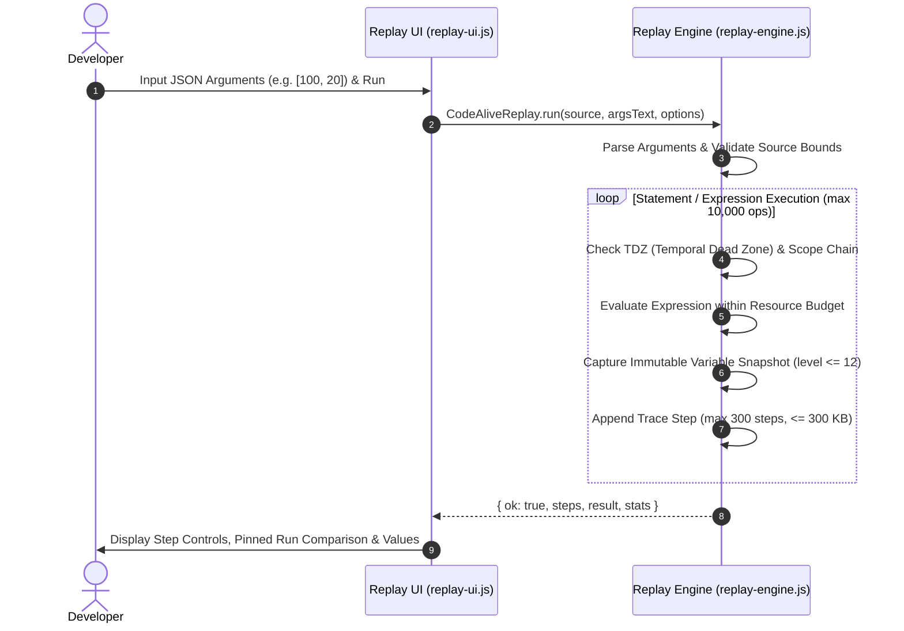
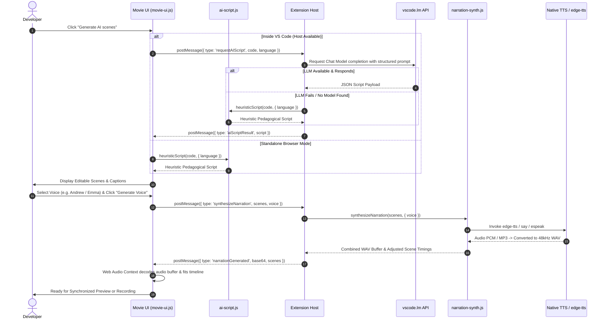
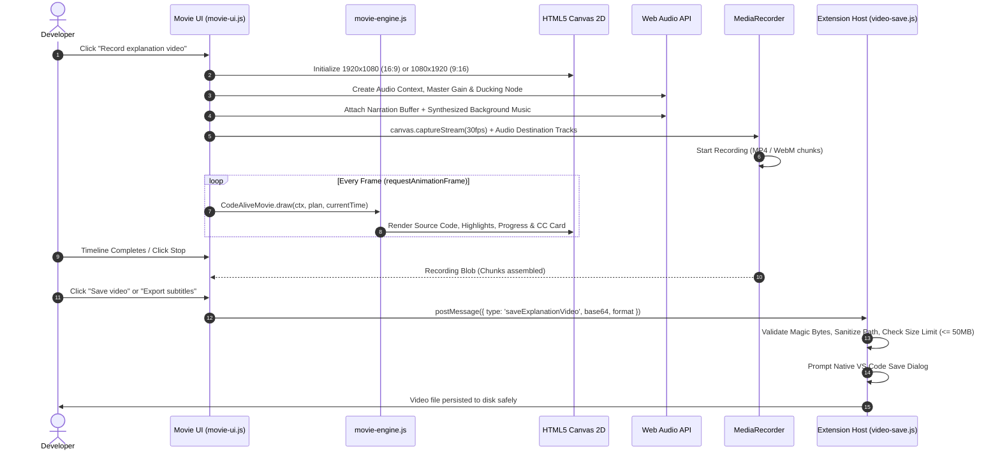

# CodeAlive Architecture & System Design

This document details the architectural design, component model, data flow, IPC protocols, and security boundaries of **CodeAlive**.

---

## 1. System Overview

CodeAlive is a local-first developer intelligence and visual explanation tool for JavaScript and TypeScript. It operates in two environments sharing the same underlying engines:
1. **VS Code Extension**: Deeply integrated into the editor with toolbar actions, active buffer tracking, Git HEAD comparison, GitHub PR inspection, and native file saving.
2. **Offline Browser Explainer**: A standalone HTML/JS bundle that runs entirely offline in any modern browser without network access or external APIs.

---

## 2. Container & Component Architecture

CodeAlive uses a modular architecture where core analysis, simulation, and rendering logic reside in `shared/` as universal JavaScript modules (UMD format) executable in both Node.js (during CI and tests) and browser/webview contexts.

```mermaid
flowchart LR
    subgraph SharedModules["Shared Universal Core (shared/)"]
        direction TB
        EE["explain-engine.js<br/>• AST Traversal<br/>• Scopes & Steps<br/>• Control Flow Graph"]
        RE["replay-engine.js<br/>• Bounded Interpreter<br/>• Immutable Snapshots<br/>• TDZ Enforcement"]
        CE["compare-engine.js<br/>• AST Fingerprinting<br/>• Fact Extraction<br/>• Semantic Deltas"]
        ME["movie-engine.js<br/>• Timeline Planning<br/>• Canvas 2D Rendering<br/>• SRT / VTT Subtitles"]
        AI["ai-script.js<br/>• Heuristic Generator<br/>• Prompt Engineering<br/>• JSON Parsing"]
        NS["narration-synth.js<br/>• PCM / WAV Framing<br/>• Multi-voice Fallback<br/>• TTS Integration"]
    end

    subgraph ExtensionModules["VS Code Extension Host (extension/)"]
        direction TB
        EXT["extension.js<br/>• Commands & Menus"]
        EP["explain-panel.js<br/>• Panel Lifecycle<br/>• LM Chat Routing"]
        CS["compare-source.js<br/>• Working Tree vs HEAD"]
        PR["pr-core.js / pr-api.js<br/>• GitHub PR & Checks"]
        VS["video-save.js<br/>• Security Guards<br/>• Disk Writing"]
    end

    subgraph UIModules["Shared UI & Presentation (shared/ & web/)"]
        EUI["explain-ui.js (Explainer UI & Tabs)"]
        MUI["movie-ui.js (Video Timeline & Controls)"]
        RUI["replay-ui.js (Playback & Snapshots)"]
        CUI["compare-ui.js (Diff & Evidence)"]
    end

    ExtensionModules --> UIModules
    UIModules --> SharedModules
```

---

## 3. Core Engine Pipelines & Sequence Flows

### 3.1 Static Code Analysis & Flow Generation

The static analyzer evaluates code structure without executing it, constructing beginner-friendly explanations and an explicit control flow graph (CFG).

### 3.2 Bounded Replay Execution & Snapshot Tracing

The replay engine is a sandboxed, deterministic interpreter supporting a safe synchronous subset of JavaScript/TypeScript.

### 3.3 AI Pedagogical Script & Neural Voice Synthesis

CodeAlive generates multi-scene narrative scripts with voice narration and synchronized captions.

### 3.4 MediaRecorder Composition & Video Export

Video frames and audio streams are composed in real-time in the browser/webview canvas.

---

## 4. Security Architecture & Isolation Guarantees

CodeAlive enforces rigorous defense-in-depth isolation across all environments:

| Boundary | Policy / Guarantee |
|---|---|
| **Content Security Policy (CSP)** | Webviews restrict `default-src 'none'`. Scripts and styles use explicit nonces or hashes. `connect-src` blocks all outbound network requests (except local blob URLs for media). |
| **Untrusted Code Execution** | Explanations and comparisons **never execute source code**. The replay interpreter forbids `eval`, `Function`, `require`, `import`, prototype pollution (`__proto__`, `prototype`, `constructor`), and object coercion. |
| **Resource Budgets** | Bounded bounds everywhere: Source max 50,000 chars; Replay max 10,000 ops, 300 steps, recursion depth 12; Video max 20 scenes, 120 seconds, 50 MB output. |
| **Token & Credential Isolation** | GitHub personal access tokens used for PR companion reviews live exclusively in the VS Code Extension Host (Node.js) and are **never transmitted** into the webview payload. |
| **Safe Disk Writes** | `extension/video-save.js` enforces user-directed destination selection via VS Code's native file picker (`showSaveDialog`). Arbitrary supplied paths from the webview are rejected. Video files require valid MP4 (`ftyp`) or WebM (`1A 45 DF A3`) magic byte headers. |
